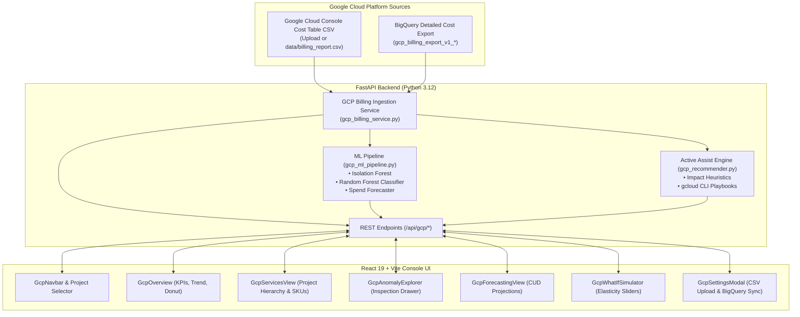

# Google Cloud Cost Guardrail & Real-Time FinOps Analyzer

<div align="center">

[](https://fastapi.tiangolo.com)
[](https://react.dev)
[](https://cloud.google.com)
[](https://scikit-learn.org)
[](https://vitejs.dev)
[](https://python.org)
[-4CAF50.svg?style=for-the-badge&logo=pytest&logoColor=white)](https://pytest.org)

**An enterprise-grade Google Cloud Platform (GCP) Cost Intelligence, Anomaly Detection, and Active Assist FinOps platform.**  
Designed to mirror Google Cloud Console's internal FinOps tools, it analyzes multi-project cloud telemetry, pinpoints cost anomalies with machine learning, and prescribes actionable remediation with 1-click `gcloud` CLI commands.

[Key Features](#key-features) • [Architecture](#architecture) • [Ingestion Modes](#dual-ingestion-modes) • [Quickstart](#quickstart-guide) • [API Reference](#rest-api-reference)

---

</div>

## Key Features

### 1. Dual Ingestion Pipeline (Zero-Setup CSV + Live BigQuery)
- **Instant Console CSV Upload**: No BigQuery export required. Download your **Cost Table** or **Reports** CSV directly from Google Cloud Billing Console and drag & drop or upload in seconds.
- **Enterprise BigQuery Streaming**: Seamlessly queries Google Cloud's official **Detailed Usage Cost Export** tables (`gcp_billing_export_v1_*` or `gcp_billing_export_resource_v1_*`) via Application Default Credentials (ADC) or Service Account JSON.
- **Multi-Currency & Locale Engine**: Dynamically detects Indian Rupee (`INR` / `₹`), US Dollar (`USD` / `$`), Euro (`EUR` / `€`), and formats currency according to regional standards (`en-IN` / `en-US`).

### 2. Google Cloud Console Design System & Brand SVGs
- Built with Google's dark Console theme palette (`#202124` surface, `#1a73e8` accent, `#34a853` FinOps green).
- High-fidelity official Google Cloud SVG brand icons for:
  - **Gemini API** / Vertex AI
  - **Cloud Run** & **App Engine**
  - **Firestore** & **Datastore**
  - **Artifact Registry** & **Cloud Build**
  - **Secret Manager**
  - **Firebase App Hosting**
  - **Google Maps Platform** / Places API
  - **Compute Engine** & **Persistent Disk**
  - **BigQuery** & **Cloud SQL**
  - **Cloud Logging**, **Cloud Monitoring**, and **Networking**

### 3. Machine Learning Spend Intelligence
- **Isolation Forest Anomaly Detection (120 Estimators)**:
  - Scans time-series telemetry across projects and services.
  - Flags cost deviations, sudden volume surges, and uncharacteristic SKU burns with statistical confidence scores.
- **Random Forest Root-Cause Attribution**:
  - Classifies anomaly root causes into high-impact operational buckets:
    - *Uncached Firestore Read Surges*
    - *Cloud Run Idle Min-Instance Allocation*
    - *Stale Artifact Registry Container Images*
    - *Unpartitioned BigQuery Full Table Scans*
    - *Secret Manager Inefficient High-Frequency Polling*
    - *Compute Engine Unattached Persistent Disks*
- **Trend Spend Forecaster**:
  - Projects 7, 30, and 90-day forward spend trajectories based on daily telemetry patterns.
  - Simulates 1-Year and 3-Year **Committed Use Discount (CUD)** savings curves.

### 4. Google Cloud Active Assist Recommender
- Prescribes high-impact cost optimizations mapped directly to user-discovered GCP services.
- Real-world actionable playbooks:
  - **Cloud Run**: Set minimum instances to 0 for dev/staging environments (`--min-instances=0`).
  - **Firestore / App Engine**: Implement cache-aside patterns with Cloud Memorystore to slash read operations.
  - **Artifact Registry**: Deploy automated cleanup policies to purge untagged historical Docker manifests.
  - **Gemini API**: Turn on Gemini Context Caching for recurring enterprise system prompts.
  - **Secret Manager**: Cache secrets in runtime memory or integrate Cloud KMS version destroy policies.
- Includes estimated monthly savings and **1-click copyable `gcloud` CLI commands**.

### 5. Interactive FinOps What-If Simulator
- Sliders for compute rightsizing, container instance scaling, database query caching, storage lifecycle transition, and CUD commitment coverage.
- Live reactive recalculation of daily, monthly, and annualized savings.

---

## Architecture



---

## Dual Ingestion Modes

### Mode A: Instant Google Cloud Console CSV (Recommended for Quickstart)
No BigQuery export setup or GCP IAM permissions needed:
1. Go to **Google Cloud Console** > **Billing** > **Cost Table** (or **Reports**).
2. Choose your date range, click **Export to CSV**.
3. In the web application, click **GCP Connect** in the navbar, drag and drop the CSV into **Upload Billing CSV**, and click **Upload & Analyze Now**.
4. Alternatively, place the exported file as `data/billing_report.csv` in the project root—the application automatically detects and parses it on startup.

### Mode B: BigQuery Detailed Usage Cost Streaming
For continuous live sync:
1. In Google Cloud Console, enable **Billing export > BigQuery export > Detailed usage cost**.
2. Click **GCP Connect** in the navbar and switch to the **Live BigQuery Stream** tab.
3. Provide your `Project ID`, `Dataset Name`, `Table ID`, and Service Account JSON key path (or leave empty to use ADC `gcloud auth application-default login`).
4. Click **Test Live BigQuery Connection** and **Save & Sync Telemetry**.

---

## Quickstart Guide

### Prerequisites
- Python 3.10+ (tested on Python 3.12)
- Node.js 18+ (tested on Node.js 22)

### 1. Backend Setup
```bash
# Navigate to the repository root
cd cloud-cost-guardrail

# Install Python dependencies
pip install -r backend/requirements.txt

# Start the FastAPI server
python -m uvicorn backend.main:app --host 127.0.0.1 --port 8000 --reload
```
The FastAPI backend will start at `http://127.0.0.1:8000`. You can explore interactive Swagger docs at `http://127.0.0.1:8000/docs`.

### 2. Frontend Setup
```bash
# In a separate terminal, navigate to the frontend directory
cd frontend

# Install dependencies
npm install

# Start the Vite development server
npm run dev
```
Open your browser at `http://localhost:5173`.

### 3. Automated Test Suite
Run the 21 automated tests covering billing ingestion, currency parsing, anomaly detection, forecasting, and API endpoints:
```bash
pytest tests/
```

---

## REST API Reference

| Endpoint | Method | Description |
| :--- | :---: | :--- |
| `/api/gcp/summary` | `GET` | Billing summary: gross spend, credits, net spend, run rate, currency symbol (`₹`/`$`). |
| `/api/gcp/projects` | `GET` | List of all monitored GCP projects with individual project spends. |
| `/api/gcp/services` | `GET` | Granular breakdown of spend across GCP services (with icons, categories, percentages). |
| `/api/gcp/skus` | `GET` | Itemized SKU consumption table sorted by highest cost. |
| `/api/gcp/daily-costs` | `GET` | Historical daily spend timeline aggregated across projects and services. |
| `/api/gcp/upload-billing-csv` | `POST` | Upload and hot-reload any Google Cloud Console Cost Table / Reports CSV file. |
| `/api/anomalies` | `GET` | ML Isolation Forest detected spend anomalies with severity and timestamps. |
| `/api/root-causes` | `GET` | Random Forest attribution of detected anomalies to operational root causes. |
| `/api/forecast` | `GET` | Projected spend trajectory over 7, 30, and 90 days with CUD commitment overlays. |
| `/api/recommendations` | `GET` | Active Assist recommendations with estimated savings and copyable `gcloud` commands. |
| `/api/what-if` | `POST` | FinOps elasticity simulator calculating adjusted spend from optimization parameters. |
| `/api/health` | `GET` | Health check endpoint returning backend connection status. |

---

## Project Structure

```
cloud-cost-guardrail/
├── backend/
│   ├── gcp_billing_service.py     # CSV parsing, BigQuery client, currency sanitization
│   ├── gcp_ml_pipeline.py         # Isolation Forest, Random Forest & Linear Forecaster
│   ├── gcp_recommender.py         # Active Assist playbooks & copyable gcloud CLI commands
│   ├── main.py                    # FastAPI application initialization & lifespan
│   ├── dependencies.py            # Singleton service injection
│   ├── schemas.py                 # Pydantic request/response schemas
│   ├── requirements.txt           # Python dependencies
│   └── routers/
│       └── api.py                 # REST route controllers
├── frontend/
│   ├── src/
│   │   ├── components/
│   │   │   ├── GcpIcons.jsx              # Official Google Cloud SVG brand icons
│   │   │   ├── GcpNavbar.jsx             # Google Cloud Console header & project picker
│   │   │   ├── GcpOverview.jsx           # FinOps cards, spend timeline, service donut
│   │   │   ├── GcpServicesView.jsx       # Project hierarchy & SKU consumption table
│   │   │   ├── GcpAnomalyExplorer.jsx    # Isolation Forest anomaly inspection drawer
│   │   │   ├── GcpForecastingView.jsx    # Forward projections & 1-Yr/3-Yr CUD savings
│   │   │   ├── GcpRecommendationsView.jsx# Active Assist cards with 1-click gcloud copy
│   │   │   ├── GcpWhatIfSimulator.jsx    # Interactive FinOps elasticity sliders
│   │   │   └── GcpSettingsModal.jsx      # CSV drag-and-drop & BigQuery configuration
│   │   ├── App.jsx                       # Main application shell & tab navigation
│   │   └── App.css                       # Google Cloud Console dark theme CSS
│   ├── package.json
│   └── vite.config.js
├── data/
│   ├── billing_report.csv         # Active Google Cloud Console billing export
│   └── gcp/                       # BigQuery config store
├── models/
│   └── gcp/                       # Trained Scikit-Learn model artifacts (.joblib)
├── tests/
│   ├── test_gcp_billing.py        # Dedicated GCP billing & ML test suite
│   ├── test_anomaly.py
│   ├── test_forecast.py
│   ├── test_integration.py
│   └── test_what_if.py
├── .gitignore                     # Git ignore rules
└── README.md                      # Documentation
```

---

## License

This project is licensed under the Apache 2.0 License - see the LICENSE file for details.
